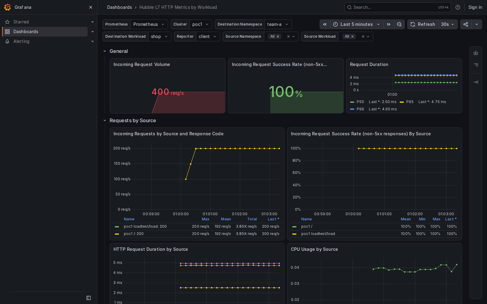

# Local ARM64 GHCR Hubble qualification

Run on this MacBook inside the dedicated Ubuntu ARM64 Colima VM. Image/chart source is `93041b3f7ec55ff12c83ecd266f14fb392ea5c93`, upstream dashboard baseline `fe561573e0a8adc43bacbcc70bda0c9e01d6676d`. The load/browser implementation is from signed-off PR head `2118a6a6de1539bfabc996c3f6a9f868d4b54c9e`. The metadata correction in `87d9282dd2053a051b4682754669b04618294a34` was then verified against the same running deployment: `grafana-health.json` records the actual Grafana 13.2.1 response and `source.json` includes that version.

The published-mode selector pulled our public GHCR agent/operator digest pins and installed the matching source chart in a temporary two-node kind cluster. Assertions verified both deployed component references, the native ARM64 agent source version, the backend on the control-plane node and Gateway metrics on the worker.

Three real six-minute HTTP streams ran before and throughout browser capture. The normal measured-load collector passed for all 151,200 requests:

| Stream | Requests | HTTP 200 | Actual requests/s | Seconds |
| --- | ---: | ---: | ---: | ---: |
| gateway | 72000 | 72000 | 199.980 | 360.036 |
| pod-gateway | 72000 | 72000 | 199.980 | 360.037 |
| direct | 7200 | 7200 | 19.997 | 360.052 |

The measured baseline All query returned 199.980 requests/s and the fixed All query 399.940, including the external Gateway increment. The browser independently verified baseline/fixed results grouped by destination and source, explicit direct-pod selection at 20 requests/s, explicit pod-Gateway selection at 200 requests/s and the complete dashboard. All seven cases passed; all eleven dashboard panels had data. `walk-results.json` and `walk.log` retain the per-page query assertions. The overview PNG was visually inspected.

Supplementary PromQL unit fixtures are explicitly marked synthetic in `results.json`; no synthetic exporter was started for the deployed test. The live metrics came from Fortio traffic through our Cilium images. The generic pinned PoC bootstrap printed an unreadable architecture-manifest preflight result; the selected kind image subsequently booted natively on ARM64. Transient Quay monitoring pulls recovered through normal retries.

This is an HTTP dashboard and published-image qualification. It does not establish workload mTLS, authorization enforcement or node encryption. The separate CMTC two-cluster lab was retained during this temporary-cluster run.
