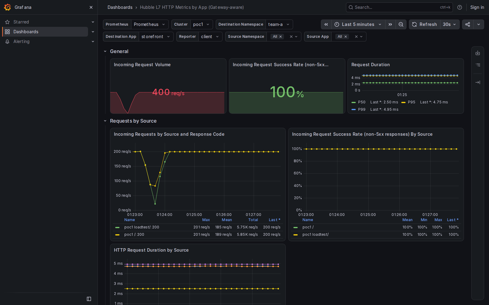

# Local ARM64 GHCR Hubble by-app qualification

Run on this MacBook inside the dedicated Ubuntu ARM64 Colima VM. Image/chart source: `93041b3f7ec55ff12c83ecd266f14fb392ea5c93`; upstream dashboard baseline: `fe561573e0a8adc43bacbcc70bda0c9e01d6676d`; signed-off helper head: `c6b47722c1c4a1bd7ed8bdf62de553c4307943d7`.

The generator is copied byte for byte from `ephico2real2/cilium-implementation-poc` commit `22fb6e14c0cca8c78af1f072d1e89ebaea6a916b`, `demos/37-two-gateways/l7-by-app-dashboard.py`. Its SHA256 is recorded in `source.json`. Its lab-mode output is provisioned beside the existing workload dashboard. Backend app `storefront` differs from workload `shop`; source app `checkout-client` differs from workload `load`. CPU panels are omitted from the app dashboard by the original generator.

This run reused the GHCR-backed two-node cluster installed for the preceding local qualification, updated its dashboard ConfigMap and app labels, restarted only the test client and started three fresh six-minute loads. Both deployed component references, the native ARM64 agent source, remote backend placement and actual Grafana health/version were asserted again. CI separately installs a fresh cluster.

| Stream | Requests | HTTP 200 | Actual requests/s | Seconds |
| --- | ---: | ---: | ---: | ---: |
| gateway | 72000 | 72000 | 199.980 | 360.036 |
| pod-gateway | 72000 | 72000 | 199.980 | 360.036 |
| direct | 7200 | 7200 | 19.997 | 360.052 |

All 151,200 requests passed the measured-load gate. App All returned 399.960 requests/s, explicit direct source app 19.980, and source namespace with app All 199.980. Gateway client metrics can carry source namespace/workload with an empty source app, so app All must retain the empty value. Workload baseline All returned 199.980 requests/s; the fixed workload All query returned 399.960.

All eleven browser cases passed during real load, including both overview pages: eleven workload panels and nine app panels with no No data results. Per-page Prometheus assertions are retained in `walk-results.json` and `walk.log`. The app overview and All PNGs were visually inspected.

Supplementary PromQL fixtures are marked synthetic in `results.json`. Live dashboard metrics come from the Fortio requests through our published Cilium images. This validates HTTP observability and image consumption; workload mTLS, authorization enforcement and node encryption remain unimplemented. The separate CMTC two-cluster lab remained running.
