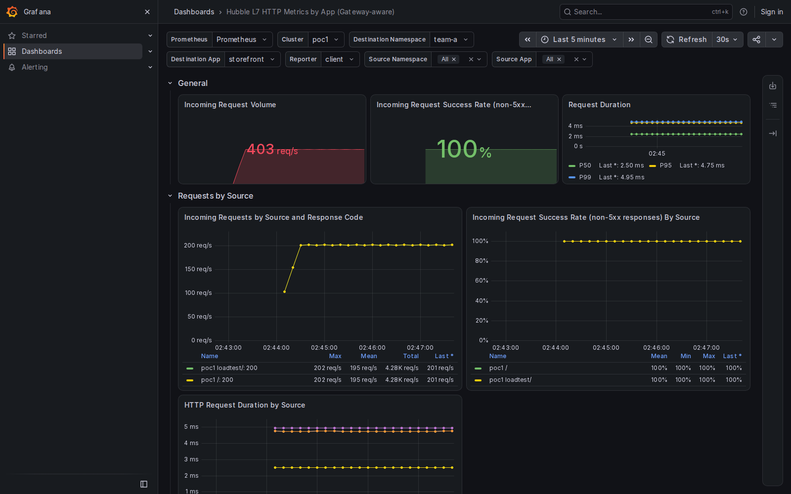

# Local Hubble qualification of the Authorization image bundle

Source `42f89f83aa5a03ea80f7a2b8cece56b27f87385a`; public fork agent/operator digests and matching chart; local Ubuntu ARM64 Colima VM on the MacBook. Three six-minute Fortio streams returned **151,200/151,200 HTTP 200 responses** (72,000 external Gateway, 72,000 pod Gateway, 7,200 direct).

All eleven browser cases passed during active load. The workload overview has eleven panels and the imported app overview nine, all with data. The before/after Gateway filter measured about 201 versus 402 requests/s. Explicit direct and pod-Gateway selections preserved their measured traffic. Raw queries, placement, deployed versions, load results and PNGs accompany this report. Grafana 13.2.1 was used.

The first cluster-creation attempt could not create kubeconfig lock files on the Mac mount. The successful run used `/home/olasumbo.guest/.kube/cmtc-hubble-authorization` in the VM and resumed against the same newly created cluster; local-resume.patch records the sole installer adjustment. The pinned source/chart/dashboard and application traffic were unchanged. No kubeconfig or signing material is included. The local test completed before Hubble CI was dispatched.

This is HTTP/dashboard evidence, not workload-mTLS or node-encryption evidence.

